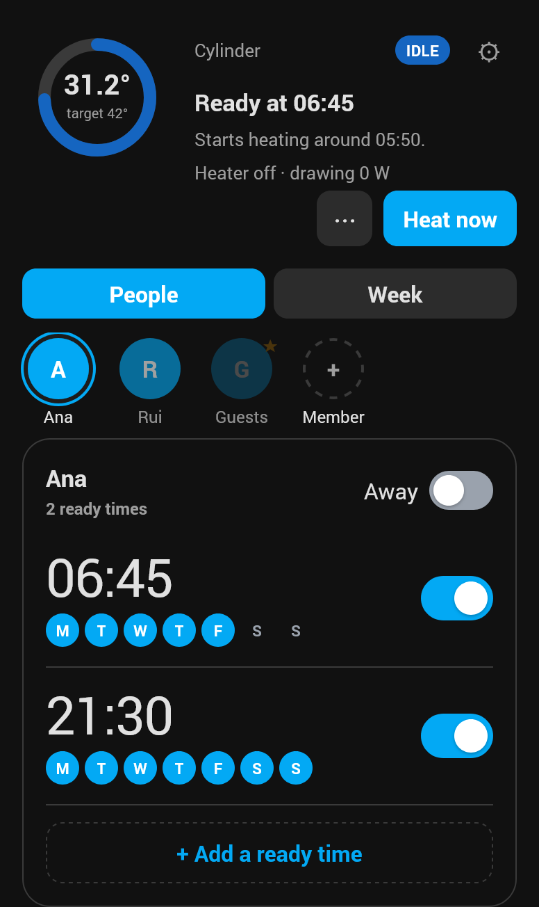
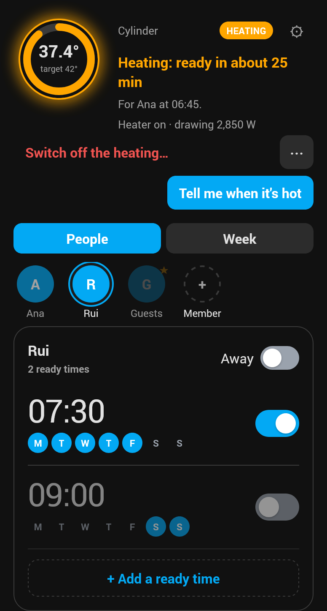
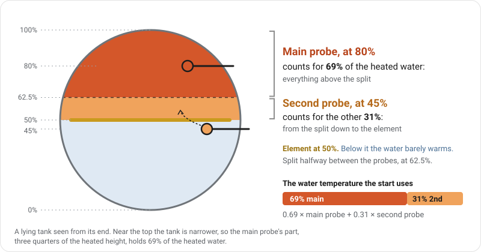
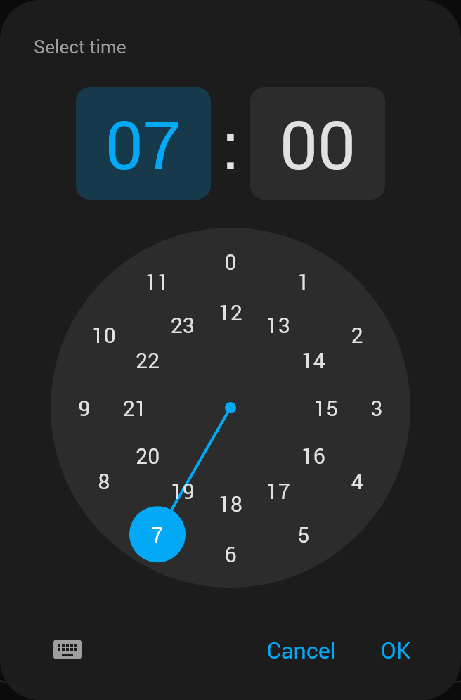
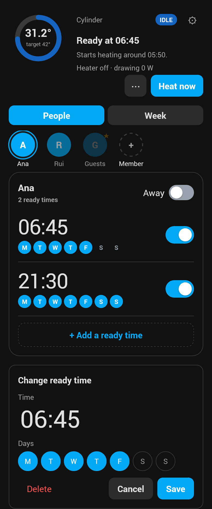
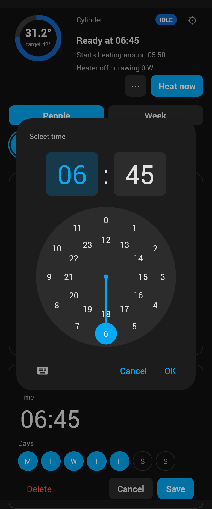
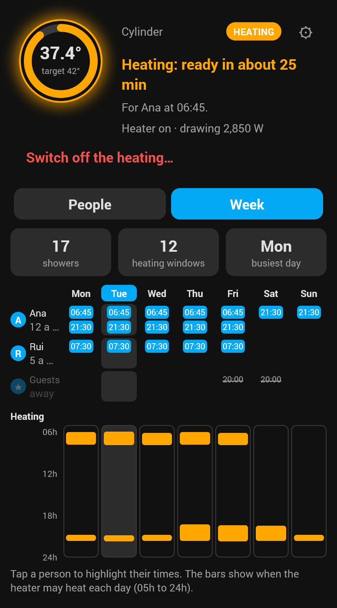
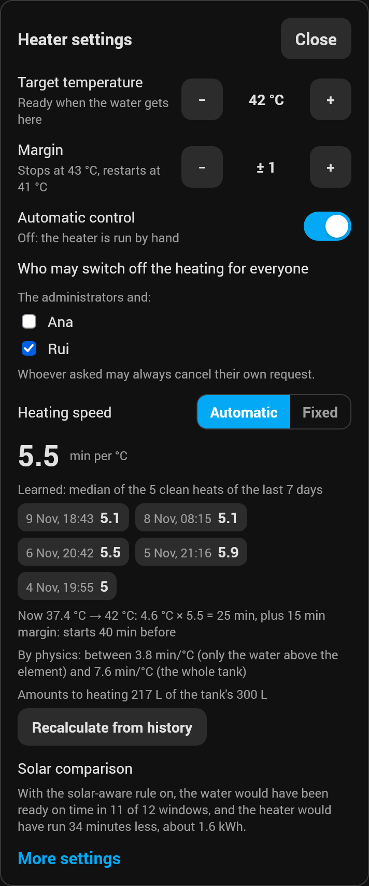
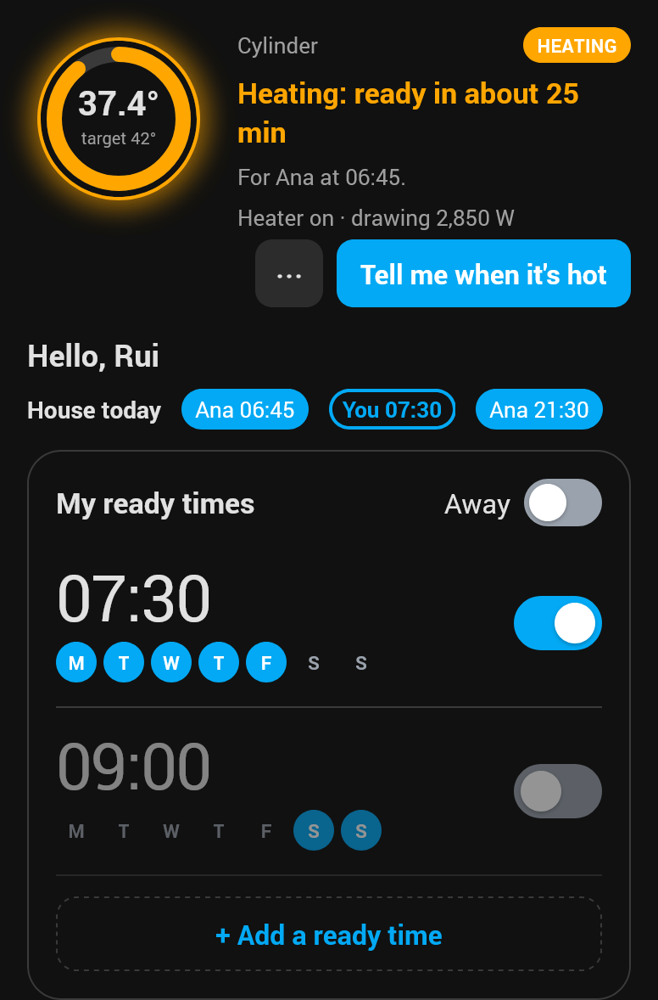

# Hot Water Ready

A Home Assistant integration that makes stored hot water ready when the people in a household
want it. Each member sets the times they want hot water; the integration works out when to start
the heater, keeps it in a temperature band, and tells them when the water is ready. It brings its
own dashboard card.

Requires Home Assistant 2026.10 or later. The integration and the card follow Home Assistant's
language: English, European and Brazilian Portuguese, German, French, Spanish, Italian, Dutch,
Polish, Swedish, Danish, Norwegian, Czech, Russian, Ukrainian, Japanese and Simplified Chinese
(any other language shows English).

<table>
  <tr>
    <td align="center"><br>Waiting for the next ready time</td>
    <td align="center"><br>Heating</td>
  </tr>
</table>

## What you need

- Something that heats the water, either:
  - a **switch** (a relay on the element), with the integration running the temperature band
    itself; or
  - an existing **climate** entity (a thermostat), which the integration sets to heat or off and
    gives a target. It must offer the modes `heat` and `off`.
- A **temperature sensor** in the water. Both setups need one.
- Optional: a **power sensor** on the heater, so a heater that draws nothing, or a relay stuck
  on, is noticed.
- Optional: a **second temperature probe** lower in the tank, so the start allows for cold water
  below the top and a probe coming loose is noticed (see *Two probes*).

## Install

Through Home Assistant's Marketplace: add this repository, `coin/hot-water-ready`, as a custom
repository of type *Integration*, install *Hot Water Ready*, and restart Home Assistant. Then add
the integration from *Settings → Devices & services → Add integration*. New versions are installed
from the Marketplace too.

By hand: copy `custom_components/hot_water_ready` into your configuration's `custom_components`
folder and restart.

The card is loaded by the integration itself; there is no separate resource to add. On a
dashboard, add the card *Hot Water Ready*.

## Setting up a heater

The setup asks for a name, the heater (switch or climate), the water temperature sensor and,
optionally, a power sensor. Each heater is its own entry; a house with two heaters adds two.
The heater setup can be changed later with *Reconfigure*.

Everything else is in the heater's options (*Configure*):

| Option | What it does |
|---|---|
| Keep heating through gaps shorter than | Ready times this close share one heating window, and the heater keeps going between them instead of letting the water cool (default 40 min). |
| After heat now, keep the water hot for | After the "hot water ready" message, heat now keeps the water between target minus and plus the margin this long, then switches off (default 5 min; 0 stops at the message). On the card, hold the button for half a second, or press ⋯, to pick 5 min to 2 h for that request only. |
| Use the solar-aware rule | Off by default. Off, the start is worked out from the heater alone and the solar-aware result is only recorded, for the comparison on the card. |
| Heating rate set by hand | Minutes to raise the water one degree. Empty: learned from the heater's own clean runs (started with the sun down, over 15 min, a rise of more than 3 °C, no water drawn), the median of the last week once there are three. |
| Tank volume, element power | Both together let the heater heat higher for showers close together that the tank at the normal target cannot carry. The element power also gives the solar comparison its kWh without a power sensor. |
| Second probe, lower down | A probe in the middle of the tank. The start comes forward when the water below the top is colder (the two probes' mean), learning uses the same, and both probes are checked after each long heat from a mixed tank against how they normally behave and against physics: a probe that is coming loose rises slower, and is reported in Repairs after two such heats. The top colder than the middle for half an hour is reported too. Heating goes on; ready still follows the main probe. |
| Height of the main probe, height of the second probe | From the bottom (0%) to the top (100%) of the tank. With both, each probe counts for the heated water nearest it (the water above the element, split halfway between the probes; circle segments in a lying tank), so the mean the start is worked out from is weighted. Without them, half each. |
| Tank position, where the element sits | Heat rises, so the water below the element barely warms. With the volume and power, these give the range the heating speed should fall in, from only the water above the element to the whole tank; the card's settings sheet warns when the learned speed is far outside it. |
| Highest temperature for showers close together | The cap for that raise: 50 °C by default, the scald limit without a mixing valve; up to 60 °C only with one. |
| People who may switch off the heating for everyone | Besides the administrators, who may always. Whoever asked for heat now may always cancel their own request. |
| Replace earlier messages on phones | On phones with the Home Assistant app, "ready" replaces "heating" instead of arriving as a second message. |
| Heater power sensor | With one, a heater that draws nothing while on, or power while switched off, is noticed. |
| Who is told about faults | Empty: every administrator. |
| Fault thresholds | Advanced, collapsed: how long a silent sensor, or a heater that does not warm the water, is tolerated before it counts as a fault. |

### Two probes

A second probe lower down tells the integration how much of the tank is hot, not only the top.
With both heights set, each probe counts for the heated water nearest it; in a lying tank the
slices near the top hold less water than those near the middle, so the top probe's 20% of the
height is 69% of the heated water here:

<p align="center"></p>

The target temperature and the margin are on the card and as number entities. Heating stops at
target plus margin and starts again at target minus margin; the water is *ready* at the target.

## Members

Members are added under the heater (*Add member*):

- A **linked** member is a Home Assistant person. They are told on their person's phones (or on
  notification targets you choose), and the user behind that person may edit their own ready
  times and away on the card.
- A **virtual** member (such as "Global" or "Guests") has no person; you choose who, if anyone,
  is told for it.

Each member has a colour for the card, and a device with an *away* switch and a *next ready time*
sensor.

**Permissions**, checked by the integration whatever the card shows: an administrator edits every
member, adds members and changes the settings; a linked member edits only their own ready times
and away. Automations and Home Assistant itself may do anything.

## Ready times and away

A ready time is a time of day and the weekdays it repeats on, and can be switched off without
being removed. Ready times close together share one heating window (see the gap above). The
start of a window is worked out from the water temperature and the heating rate, plus a margin;
once the heater has started for a window it carries on until the water is ready.

A ready time is set on a clock face, like a phone's alarm: hours (0 to 11 outside, 12 to 23
inside), then minutes. The keyboard button types it instead.

<p align="center"></p>

Tapping a ready time opens it to change its time or days, or to delete it; tapping the time opens
the clock. *+ Add a ready time* opens the clock straight away.

<table>
  <tr>
    <td align="center"><br>Changing a ready time</td>
    <td align="center"><br>Picking its time</td>
  </tr>
</table>

**Away** pauses a member's ready times, optionally until a last day, after which it ends by itself.

**Private** keeps a member's ready times and heat-now requests to themselves and the
administrators. Other members' cards leave them out, and show the heater heating only for their
own times and requests, from when their own window would start; the element's state and power
are left out for them too. The calendar and the next ready time sensors leave private times out
for everyone; the status sensor stays true. A member sets their own; an administrator sets a
virtual member's, but not another person's. The switch is behind the ⚙ next to the title of one's own
ready times, so nobody else sees it on the card. Home Assistant has no per-entity permissions, so the
relay, the power sensor, History and the temperature rising stay visible to anyone who looks.

## The card

- **Top**: the water temperature in a ring with the target, a plain sentence ("Ready at 07:00",
  "Heating: ready in about 15 min") and the *Heat now* button. While the heater heats, the ring
  glows and the button becomes *Tell me when it's hot*.
- **People** (administrators): the members as avatars, the selected member's ready times like
  alarms (time, weekdays, on or off), *+* to add one, and the away switch.
- **Week** (administrators): the household's week, people by day, with the number of showers and
  heating windows, a heating bar per day (05h to 24h), and a tap on a person to highlight them.
- **Settings** (the cog, administrators): target, margin (shown as where heating stops and starts
  again), automatic control, who may switch off the heating for everyone, and the solar comparison.
- **A member** sees a greeting, their own ready times and away, and a read-only line with the rest
  of the house today.

Red banners show faults; an orange one warns when showers close together need more than the
highest temperature allows.

<table>
  <tr>
    <td align="center"><br>Week</td>
    <td align="center"><br>Settings</td>
    <td align="center"><br>A member</td>
  </tr>
</table>

**Heating speed** (in the settings): the minutes per degree in use and where they come from
(learned, the starting value, or fixed by hand), the clean heats behind it, how the start works
out from the water now, and the range physics allows for the tank. *Fixed* steps it by hand,
with the learned value as a suggestion; *Recalculate from history* relearns it from the last
week of Home Assistant's history and uses the result at once.

## Heat now

*Heat now* (on the card, the button entity, or the action) heats the water to the target as soon
as possible. Several people can ask; each is told when it is ready. While the heater is heating,
*Tell me when it's hot* joins in. Pressing again takes only your own place out: heating stops
when the last person leaves. It is refused, with the reason, during a fault or while automatic
control is off.

**Keeping it hot**: after the message the heater keeps the water hot for 5 minutes (an option),
heating again if it drops to the target minus the margin, then switches off without another
message. The card shows *Keeping hot until 18:25*. Hold *Heat now* for half a second, or press
⋯ next to it, to pick 5, 15 or 30 minutes, 1 or 2 hours for that request. Each person's time
starts at their own message, and they leave the request when it is up; heating stops when the
last one leaves. The `heat_now` action takes `keep_minutes` for the same.

**Your own temperature** (administrators): the same sheet also has a temperature, one degree at a
time from 35 to 45 °C, starting at the heater's target. It is for that request only; the heater's
target does not change. With several people asking, the heater heats to the highest temperature
among them, and each is told when the water reaches their own: someone who asked for the target
is told at it while an administrator's higher request heats on. The card's ring shows your own
temperature while your request runs. The `heat_now` action takes `target` for the same, from an
administrator or an automation.

**Switching off for everyone**: administrators, and the people chosen in the options, also see
*Switch off the heating…* while it heats, which asks for confirmation and names who loses out.
It ends the heat-now request and skips the ready times being heated for, until that window would
have ended; then the heater works normally again. Everyone who loses out is told who switched it
off, or only that it was switched off when an automation did it, with the `switch_off` action.
The same link also shows when a heat-now request waits without heating (during a fault, or with
automatic control off): switching off then ends that request, so it cannot start heating later.

## Faults

The card shows a red banner, a Repairs entry explains what happened, and the fault recipients
are told when:

- the temperature sensor goes silent;
- the water does not get hotter while the heater is on;
- with a power sensor: the heater draws nothing while on, or draws power while switched off.

With a second probe, a **warning** (heating goes on) is raised too when, on two long heats in a
row from a mixed tank, a probe rises much slower than it normally does or than physics allows,
or falls well behind the other one: it may be coming loose or exposed to the cold while still
rising. The top reading colder than the middle for half an hour is reported as the probes
disagreeing. A suspect second probe is left out of the start until it reads properly again.

The first three stop heating, and heat now is refused while they last. Power drawn while switched
off points at a stuck relay, which the integration cannot switch off itself: check the relay.
"Not getting hotter" and "draws nothing" are cleared with *Resolved* in Repairs, or by a later
heating that behaves normally. For a thermostat that does not say when it is heating, that check and the "draws
nothing" check are skipped; the settings sheet says so.

## Entities

| On | Entities |
|---|---|
| The heater | status (waiting, heating, ready, fault, manual); next ready time, and for whom; problem; automatic control; heat now button; target and margin; a calendar of heating windows and whose showers they serve |
| The heater, diagnostic, hidden | learned heating rate; lead; solar-aware lead |
| Each member | away; next ready time |

**Automatic control** off hands the heater to the household: the integration plans nothing and
leaves the relay alone.

## Actions

For automations and voice, with the permissions above. Members are named by their device.

```yaml
action: hot_water_ready.heat_now
data:
  heater: <config entry id of the heater>
  member: <device id of a member>  # optional: who is told when it is ready
```

Without `member`, the person behind the calling user is told; from an automation, nobody (the
card still shows the request).

```yaml
action: hot_water_ready.switch_off
data:
  heater: <config entry id of the heater>
```

```yaml
action: hot_water_ready.add_ready_time
data:
  member: <device id of a member>
  time: "07:00"
  weekdays: [mon, tue, wed, thu, fri]  # optional: left out, every day
  enabled: true  # optional
```

```yaml
action: hot_water_ready.remove_ready_time
data:
  member: <device id of a member>
  time: "07:00"  # removes that member's ready times at 07:00, whatever their days
```

```yaml
action: hot_water_ready.set_away
data:
  member: <device id of a member>
  away: true
  until: "2026-12-26"  # optional: the last day away
```

## Solar comparison and diagnostics

Whether or not the solar-aware rule is on, every heating window is recorded with what each rule
did, or would have done. The settings sheet sums up the last 30 days: on time in N of M windows,
and X minutes (about Y kWh) less with the solar-aware rule. The full record, kept a year, is in the
integration's *Download diagnostics*, with names and people left out.

## Development

- `custom_components/hot_water_ready/core/` is the scheduling core, plain Python with no Home
  Assistant imports. The rest of the package is the Home Assistant layer.
- `card/` is the dashboard card (TypeScript, Lit). `npm run build` writes the bundle the
  integration serves, `custom_components/hot_water_ready/frontend/hot-water-ready-card.js`,
  which is committed; CI fails when it is out of date.
- `scripts/check` runs every Python check CI runs (`lint`, `types`, `test ARGS`, or all).
  Home Assistant does not run on Windows; there, use `scripts\wsl-check.ps1`.
- `cd card && npm run check` runs the card's lint, types, tests and bundle check.
- `dev/testha.sh` starts a throwaway Home Assistant in Docker with a simulated cylinder;
  `python dev/trial.py` runs the trial scenarios against it and writes a report.
- `cd card && node ../dev/screenshots.mjs` renders the README's card images into `docs/images/`
  from the built card and a sample household (run `npm run build` first).
